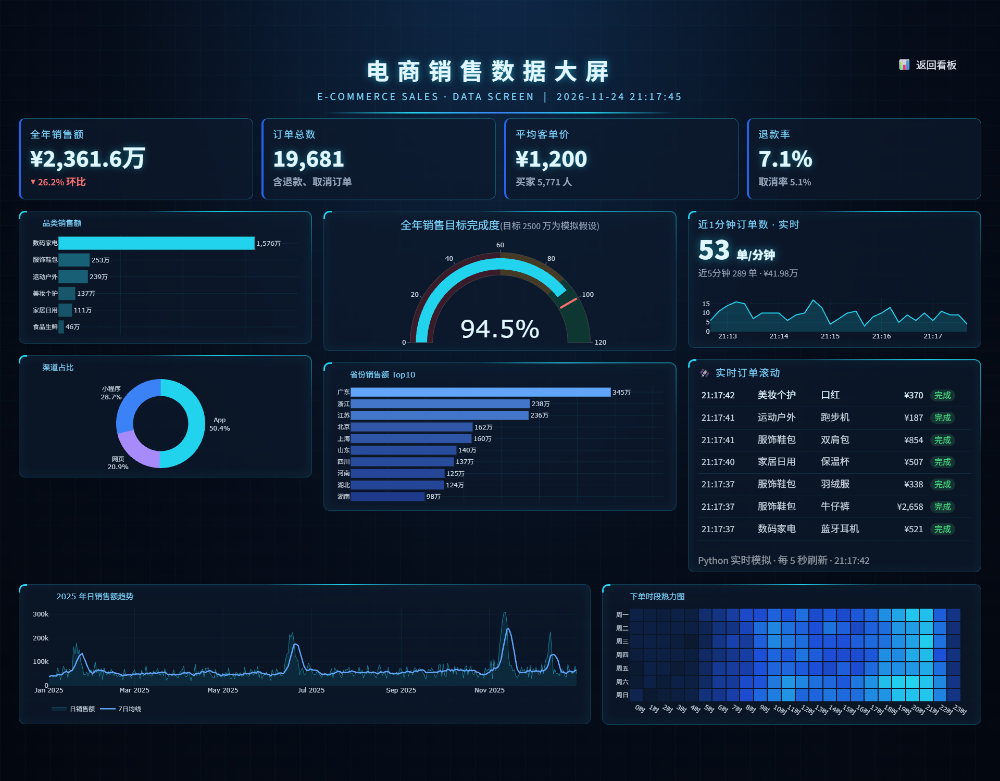

# 电商销售数据看板

基于 **Streamlit + Pandas + Plotly** 的电商销售数据看板,对应课程《实验2 数据看板的设计与实现》。
基础任务、进阶任务、扩展任务全部完成。数据为**程序模拟生成**的 2025 年全年约 2 万条订单,仅用于课程实验。

| 销售看板(亮色) | 数据大屏 |
|---|---|
|  |  |

## 功能一览

| 任务 | 内容 |
|---|---|
| **基础** | 版面设计与配色;数据生成与预处理(去重、空值、非法日期/数量、金额一致性校验);数据卡片、品类柱状图、渠道环形图、日销售额折线图;整合成静态看板 |
| **进阶1** 动态视觉 | 图表 hover 提示、KPI 数值滚动动画、组件渐入、**图表自动轮播**、自适应布局(手机/平板/桌面) |
| **进阶2** 筛选联动 | 时间 / 品类 / 渠道 / 省份 / 状态筛选;**点击品类柱状图**联动其余图表 |
| **进阶3** 多维分析 | 下单时段热力图、品类雷达图、商品 Top10 排行榜、目标进度仪表盘、极值卡片 |
| **扩展1** 实时 | Python 后台线程模拟实时订单流,2秒~1分钟自动刷新(`st.fragment`),可暂停 |
| **扩展2** 预警 | 退款率 / 取消率 / 月环比 / 每分钟订单数阈值;变色、闪烁、横幅、toast、弹窗;阈值可调 |
| **扩展3** 大屏 | 单独的大屏页面:科技风背景、动态粒子、流光边框;超宽屏与移动端适配 |
| **扩展4** 分析与导出 | 由代码自动计算分析结论;导出 Excel / CSV / 图表 PNG / **一键生成 Word 报告包(ZIP)** |
| **扩展5** 个性化 | 订单明细排序、品类→商品→省份钻取、与上一等长周期的历史对比、亮/暗主题切换 |

## 目录结构

```
├── src/                 源码
│   ├── app.py           入口(多页路由:销售看板 / 数据大屏)
│   ├── dashboard.py     主看板
│   ├── bigscreen.py     数据大屏
│   ├── common.py        配色主题、样式、KPI 卡片
│   ├── alerts.py        预警规则与弹窗
│   ├── realtime.py      实时订单流
│   ├── analysis.py      自动分析结论
│   ├── report.py        Excel / PNG / Word / ZIP 导出
│   ├── generate_data.py 生成模拟订单(含故意混入的脏数据)
│   ├── preprocess.py    数据预处理
│   └── test_*.py 等     Playwright 交互测试、截图、报告生成脚本
├── data/                orders_raw.csv(原始)、orders_clean.csv/.xlsx(清洗后)、preprocess_report.txt
├── screenshots/         最终截图 final_*.png
├── .streamlit/          Streamlit 主题配置
└── 实验二作业/           实验手册、实验报告、开发过程记录、博客文章
```

## 运行

需要 **Python 3.13**(开发时用的版本)和 **Chrome 浏览器**(图表导出为 PNG、自动化测试需要)。

```bash
# 1. 创建虚拟环境并安装依赖(Windows 可直接双击 setup.bat)
python -m venv venv
venv\Scripts\python -m pip install -r requirements.txt

# 2. 启动看板(Windows 可直接双击 run_dashboard.bat)
venv\Scripts\streamlit run src/app.py
```

浏览器打开 <http://localhost:8501>:左侧导航切换「销售看板」和「数据大屏」。

重新生成数据(可选,仓库里已带好清洗后的数据;Windows 可双击 `make_data.bat`):

```bash
venv\Scripts\python src/generate_data.py   # 生成 data/orders_raw.csv(随机种子固定,结果可复现)
venv\Scripts\python src/preprocess.py      # 清洗,输出 data/orders_clean.csv/.xlsx
```

运行交互测试(可选,需先启动看板,并安装 `requirements-dev.txt`):

```bash
venv\Scripts\python -m pip install -r requirements-dev.txt
cd src && ..\venv\Scripts\python test_interactions.py
```

> 注意:`test_*.py` 里的截图/下载输出路径写死为 `E:/pytest/...`(开发机路径),在别的机器上运行前需要改成自己的路径。

## 重要说明

- **数据是模拟的**,不代表真实业务。统计口径为全部订单(含已退款、已取消)。
- **全年销售目标 2500 万元**(仪表盘)和**预警阈值**(退款率 7.5%/9%、取消率 5.5%/7%、月环比 -15%/-30%、每分钟订单数 80/110)都是**演示用的假设**,不是真实业务标准,可在侧边栏或 `src/common.py` 中调整。
- 实时订单流是**独立的模拟模块**,没有并入 2025 年历史统计。
- 历史对比只能对比"紧邻的上一个等长周期",因为数据只有 2025 一年,所选范围不能超过数据总长度的一半。
- 已知局限:数据大屏在 1920×1080 下,底部的趋势图与热力图需要向下滚动;Plotly 环形图不支持选择事件,所以渠道图只能被联动、不能作为点击源。
- `st.html` 里的脚本只要含 `<` 字符就不会执行(已实测),代码里用 `>` 形式改写并加了断言。
