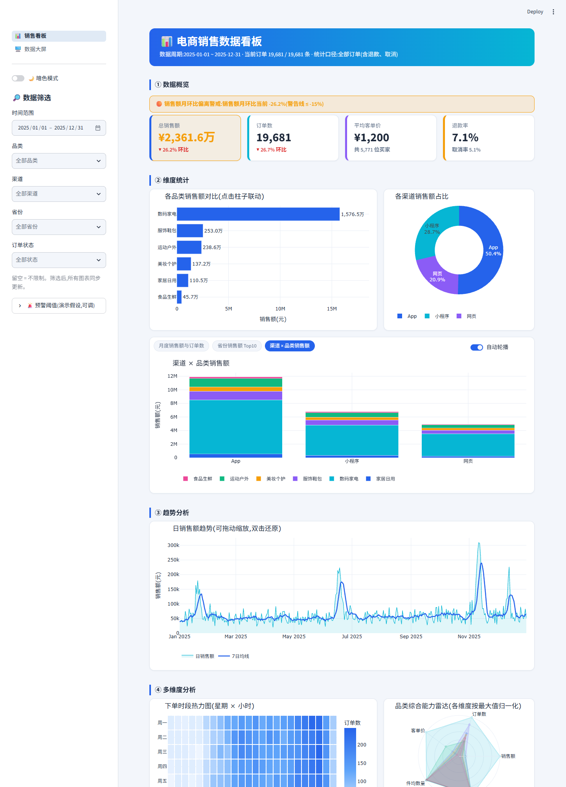
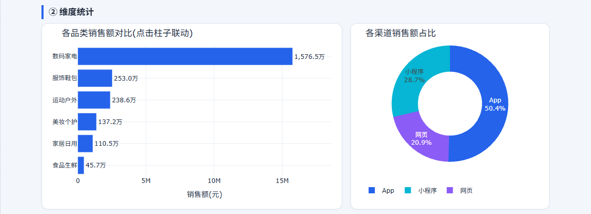
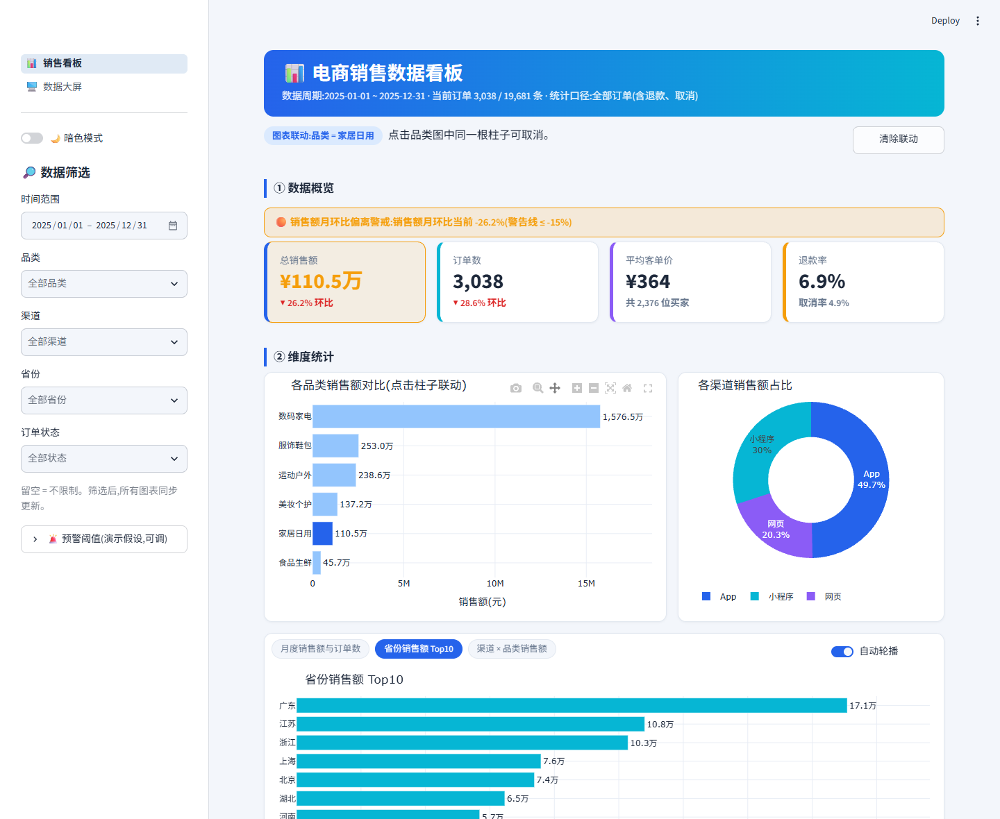
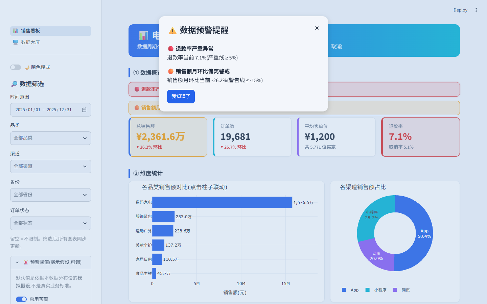
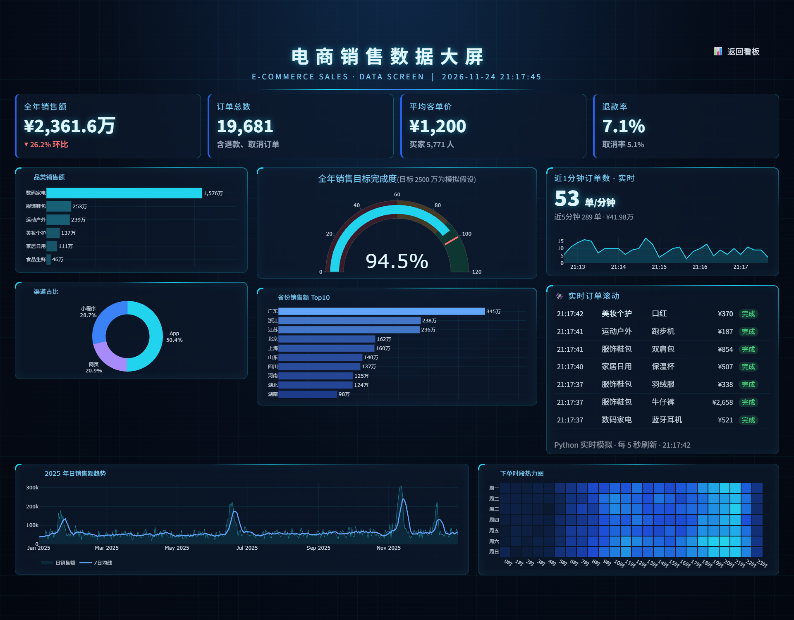

# 用 AI 辅助开发(vibe coding),从零做一个电商销售数据看板:Streamlit + Plotly 全流程与踩坑记录

> 课程实验《数据看板的设计与实现》的完整过程。基础、进阶、扩展任务全部完成。
> 本文和全部代码、数据、截图、实验报告,都在这个 GitHub 仓库里(本页就是仓库首页)。

## 一、做了什么

选了「电商销售数据」作为业务场景,用 **Streamlit + Pandas + Plotly** 做了一个有两个页面的看板:

- **销售看板**:数据卡片、品类柱状图、渠道环形图、趋势折线图,以及筛选联动、热力图、雷达图、排行榜、仪表盘、实时监控、预警、分析与导出、数据钻取、历史对比、亮/暗主题。
- **数据大屏**:科技风背景、动态粒子、流光边框,适配超宽屏和手机。

## 二、先把"需求"问清楚

这是一次 AI 辅助开发。我给自己定了一条规矩:**手册没说清的地方,AI 必须先问我,不许自己拍板,也不许编造**。结果真的问出了不少手册里没有答案的问题:

| 手册没说清的地方 | 我的决定 |
|---|---|
| 「数据自动轮播」轮播什么 | 轮播多张图表 |
| 「进度仪表盘」的目标值是多少 | 由 AI 设 2500 万,并在界面和报告里明确标注是**模拟假设** |
| 实时数据源用什么 | Python 后台线程实时模拟新订单 |
| 预警阈值设多少 | AI 设默认值并标注为假设,侧边栏可调 |
| 大屏和主看板的关系 | 单独做一个大屏页面 |

后来的事实证明这很值:有一次 AI 给用户的提示建议本身就是错的(见下文),如果当时凭想当然做决定,错误会更隐蔽。

## 三、数据:故意制造脏数据,再清洗

用脚本生成 2025 全年约 2 万条订单(固定随机种子,可复现),并**故意混入**空值、重复订单、非法数量、非法日期、被放大的异常金额,让「数据预处理」有真实的工作量。

| 步骤 | 结果 |
|---|---|
| 原始数据 | 20,080 行 |
| 去重 | 剔除 80 行 |
| 剔除关键字段空值 | 剔除 259 行 |
| 剔除非法日期 | 剔除 15 行 |
| 剔除非法数量 | 剔除 25 行 |
| 剔除金额 ≠ 数量×单价×折扣 | 剔除 20 行 |
| **清洗后** | **19,681 行** |

**一个教训**:我最初还加了「IQR 3 倍离群值」一步,结果一次删了 434 行,远多于故意注入的 20 条异常——它把真实的大额订单(一次买 5 件手机)也当成异常删掉了。去掉它,改用「实付金额必须等于数量×单价×折扣」来校验,准确得多。

## 四、几个有意思的功能

**图表联动**:点击品类柱状图的一根柱子,其余图表只显示该品类。实测点「家居日用」后订单数从 19,681 变成 3,038,和 pandas 单独统计的结果一致。

**实时看板**:后台线程按泊松过程不断"下单",看板用 `st.fragment(run_every=...)` 只刷新这一块,不重绘整页。刷新间隔 2 秒到 1 分钟可选,可暂停。

**预警**:退款率、取消率、月环比、每分钟订单数超过阈值时,卡片变色、严重的会闪烁并弹出对话框。

**自动分析结论**:结论文字全部由代码从当前数据算出来,**不写死任何数字**,换筛选条件结论会跟着变;订单少于 50 条时程序直接拒绝下结论,避免小样本误导。

**一键报告包**:Word 报告 + Excel + 5 张图表 PNG 打成 ZIP。

**数据大屏**:

## 五、踩过的坑(都是真实遇到的)

### 1. 命令行截图是一片空白
Streamlit 页面靠 websocket 渲染,Chrome 命令行截图在渲染完成前就拍了。改用 **Playwright** 驱动 Chrome,等页面渲染完再截图。后面所有交互测试也都用它。

### 2. 数值滚动动画怎么都不动
排查走了弯路。最后发现有**两个原因叠在一起**:
- 改了被 `import` 的模块之后没重启服务,Streamlit 还在用旧代码;
- **`st.html` 里的 `<script>` 只要含有 `<` 字符就不会执行**。这个我用最小例子验证过:`if (1<2)` 不执行,不含 `<` 的脚本能执行。解决:把比较改写成 `2>1` 的形式,并在代码里加断言防止以后改坏。

这里还有一个教训:我第一次只找到了其中一个原因就下了结论,后来写的记录里把结论说成"只是没重启服务",**这是不完整的**,后来才更正。

### 3. 大屏页面一片空白
我给 `.stApp` 加了 `position: relative; z-index: 1`,把 Streamlit 的布局弄坏了——容器高度变成 0,内容全被裁掉(元素都在,但看不见)。靠脚本把各层元素的尺寸打印出来才定位到。最后让粒子画布用 `z-index: -1`,不再动 `.stApp`。

### 4. 暗色模式:控件还是白底、图表文字看不见
`st.plotly_chart` 默认套用 Streamlit 的亮色主题,会覆盖自己的配色,要传 `theme=None`。控件的白底我没有凭感觉猜选择器,而是写脚本列出"背景偏白的元素",逐个修复。

### 5. AI 给出了错误的建议
「历史对比」功能超出数据范围时,提示语建议用户"选 7~12 月"。但那段时间的上一周期仍然落在 2024 年,没有数据——**建议本身就是错的**。是真实操作测试时发现的。改成由程序计算出真正可行的区间。

### 6. 图表导出太慢
逐张导出 5 张图要 25 秒(每张都重启一次浏览器内核),改用批量导出后约 7 秒。

### 7. 工具本身也会卡
用 Word 自动化打开文件时卡死了两次,pip 下载大文件也因网络原因卡住过。处理方式都是:只结束自己启动的那个进程,换一条路(比如用 WPS 自动化完成模板转换)。

## 六、关于测试:不要只看代码

所有功能我都让 Playwright 驱动真实 Chrome 去点、去填、去下载,并用独立的 pandas 计算去核对页面上的数字:

- 数值动画:连续采样读到 774.1万 → 949.3万 → 2334.4万 → 2361.6万,确实在滚动
- 实时刷新:每 5.5 秒采样,刷新时间全不相同,累计订单 251 → 277;关掉开关后不再变化
- 导出:4 种下载都真实下到了文件;筛选 7~9 月后 Excel 明细 4,343 行、销售额合计 518.2 万,与 pandas 一致

很多问题(动画不动、页面空白、颜色看不清)只有真实打开页面操作之后才会暴露。

## 七、局限与说明

- 数据是模拟的,不代表真实业务。
- 仪表盘的 2500 万目标、预警阈值都是**演示用的假设**。
- 实时订单流是独立的模拟模块,没有并入 2025 年历史统计。
- 大屏在 1920×1080 下,底部的趋势图和热力图需要向下滚动。
- 手册的实验目的里提到了「地图」图表,我没有做:省份地图需要联网下载地图数据,而任务要求里没有硬性要求。

## 八、小结

这次最大的体会是:**AI 写代码很快,但"问清楚需求"和"真实地验证"必须由人来要求**。需求不清时让 AI 先问,做完之后用独立的方法核对数字、用真实操作测试交互——这两件事帮我挡住了好几个看起来"能跑"其实有问题的地方。
